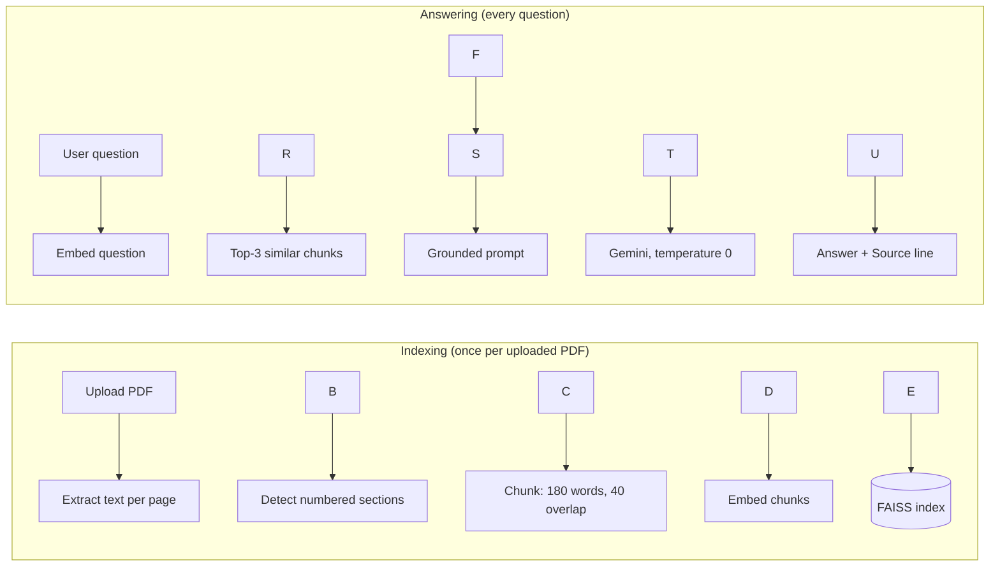

# The PDF Whisperer

An AI-powered PDF chatbot that answers questions about an uploaded document and always shows **where** the answer came from (page and section).

Built as the final project for the **IITM Pravartak** AI-Powered PDF Chatbot capstone, using a Retrieval-Augmented Generation (RAG) pipeline with Streamlit, FAISS, Sentence-Transformers and Google Gemini.

\---

## 1\. Problem statement

Organizations produce large volumes of documents such as reports, manuals, research papers and policy guidelines. Finding one relevant answer inside them by hand is slow and inefficient.

**Task:** design and build an AI chatbot that lets users ask natural-language questions about a PDF and receive relevant, document-based answers, explanations or summaries.

## 2\. Requirements

|Requirement (from the case study)|How this project meets it|
|-|-|
|Working prototype of the chatbot|Streamlit app (`Whisperer\_app.py`)|
|Document loading and processing|`pypdf` text extraction, page by page|
|Text chunking and preprocessing|Section-aware, overlapping word chunks|
|Embedding generation|`sentence-transformers/all-MiniLM-L6-v2`|
|Storage in a vector database|FAISS (`IndexFlatIP`)|
|Retrieval of relevant sections|Top-3 similarity search|
|Response generation with an LLM|Google Gemini via the `google-genai` SDK|
|Presentation, explanation, demo video|Slide deck, this README, 5–10 minute demo|

The choice of models and tools was left to the participant. The reasons for each choice are in section 5.

## 3\. How it works (to view below mermaid diagram correctly please open file in VS Code/GitHub/Mermaid)



1. **Upload.** The PDF is read with `pypdf`. A PDF with no extractable text (for example, a scan) or one that cannot be read shows a clear message instead of failing.
2. **Section-aware chunking.** Lines such as `4. Carry Forward and Encashment` or `4.1 Leave Policy` are detected as headings. Text is grouped by section and then split into 180-word chunks with a 40-word overlap. **A chunk never crosses a section boundary**, so every chunk knows its page number(s) and its section.
3. **Embedding and indexing.** Each chunk is turned into numbers (an embedding) that capture its meaning, and stored in FAISS so similar meanings can be matched quickly.
4. **Retrieval.** The question is embedded with the same model and the three closest chunks are retrieved.
5. **Generation.** Each retrieved chunk is labelled, for example `\[Passage 1 | Page 2, Section 2 - INDIA REGIONAL LEAVE POLICY]`. Gemini is told to answer only from these passages, to reply exactly *"I could not find that information in the document."* when the answer is missing, and to end with a `Source:` line.
6. **Display.** The `Source:` line is shown as its own italic line with a scroll icon.

## 4\. Code structure

All the code is in one file, split into the same steps as the RAG workflow in the case study.

|Layer|Functions|
|-|-|
|**Ingestion and indexing**|`extract\_pages\_from\_pdf`, `detect\_section\_heading`, `build\_sections`, `split\_text\_into\_chunks`, `load\_embedding\_model`, `create\_chunk\_embeddings`, `create\_faiss\_index`|
|**Retrieval**|`embed\_question`, `search\_similar\_chunks`, `retrieve\_relevant\_chunks`|
|**Augmentation and generation**|`format\_source\_label`, `build\_prompt`, `generate\_answer`, `format\_answer\_with\_source`|
|**User interface**|page setup, session state, CSS, chat avatars, the *Load* tab and the *Ask* tab|

Design notes:

* **Small, single-purpose functions** so each stage can be read, tested and explained on its own.
* **Caching:** the Gemini client, the embedding model and the user avatar use `@st.cache\_resource`, so they are created once.
* **Process once:** each upload gets a signature (file name plus an MD5 hash of its contents). The PDF is only processed when the signature changes, so chatting never triggers re-indexing.
* **Session state** holds the chat history, the FAISS index, the chunks and the document name, so both tabs share the same document.
* **Retries:** temporary Gemini errors are retried by the client's `HttpRetryOptions`.

## 5\. Why these tools

|Choice|Reason|
|-|-|
|**Streamlit**|Chat elements (`st.chat\_input`, `st.chat\_message`) and tabs give a working chat UI with very little code.|
|**pypdf**|Simple, pure-Python page-by-page text extraction.|
|**all-MiniLM-L6-v2**|Small and fast, runs on a laptop CPU, good general-purpose semantic search.|
|**FAISS**|Standard, fast vector search with no server to run.|
|**Gemini**|Strong instruction following for grounded answers, accessed through a simple API. The model is set by the `GEMINI\_MODEL` variable.|
|**Temperature 0**|Consistent answers that stick to the retrieved text.|

## 6\. UI structure

* **Title row:** a centred page title with a **Reset** button on the right that clears the chat history.
* **Two tabs**, following the user's journey:

  1. **Load your PDF scrolls** – upload a PDF. After processing, a success message, a "scroll" card with the file name, and a caption (pages, chunks and numbered sections found) are shown.
  2. **Ask the PDF Whisperer bot** – the chat. If no PDF is loaded, an info message points back to the first tab.
* **Chat layout:** the conversation is rendered in a container created *before* `st.chat\_input`, so history stays above the input box (inside a tab, `st.chat\_input` is inline rather than pinned to the bottom). User messages are right-aligned with a blue avatar; bot messages have their own avatar and an italic **Source** line.
* **Styling** is a small CSS block injected with `st.markdown`: centred title, right-aligned user messages, larger tab labels, a thicker tab underline and the scroll card.

### Why these names

The app uses one consistent metaphor: documents are *scrolls* and the bot is a *whisperer* that uncovers what is hidden in them.

|Text|Where|Reasoning|
|-|-|-|
|**The PDF Whisperer**|Page title, browser tab, header|A memorable character name that still says what the app works on (PDFs). Paired with a 📜 page icon.|
|**Load your PDF scrolls**|Tab 1|Starts with a verb to tell the user what to do; "scrolls" keeps the metaphor.|
|**Ask the PDF Whisperer bot**|Tab 2|Repeats the product name so the user knows who they are talking to, and mirrors the load-then-ask flow.|
|*What would you like me to uncover in your document?*|Caption on tab 2|Speaks in the bot's voice and invites a plain-language question.|

## 7\. Setup and run

**Requirements:** Python 3.10+ and a Gemini API key.

```powershell
# 1. Create and activate a virtual environment (Windows PowerShell)
python -m venv .venv
.\\.venv\\Scripts\\Activate.ps1

# 2. Install dependencies
pip install -r requirements.txt
```

Create a `.env` file next to `Whisperer\_app.py`:

```
GEMINI\_API\_KEY=your\_key\_here
GEMINI\_MODEL=gemini-3.5-flash-lite
```

`GEMINI\_MODEL` is optional and falls back to the default in the code.

```powershell
# 3. Run the app
streamlit run Whisperer\_app.py
```

The app opens at `http://localhost:8501`. The first run downloads the embedding model (about 90 MB).

`requirements.txt` (use `sentence-transformers` 5.0 or later, which provides `encode\_query` and `encode\_document`):

```
streamlit
python-dotenv
google-genai
pypdf
faiss-cpu
numpy
pillow
sentence-transformers>=5.0.0
```

## 8\. Live demo validation and Intriguing highlights

The app was tested with `ABC\_Bank\_Global\_HR\_Leave\_Policy.pdf`, a fictional 7-page policy covering India, APAC, EMEA and North America. It is a good test because it is long, regional and full of exceptions. These are the behaviours that stood out in the live demo.

### 1\. Precise regional answers

* **Query:** *"As a India-based ABC Bank employee, how many sick leaves can I get in a year"*
* **Result:** `8 working days`, cited as `Page 2, Section 2 - INDIA REGIONAL LEAVE POLICY`. The answer did not get mixed up with other regions' sick-leave rules, such as the UK (10 days) or Singapore (14 outpatient days).

### 2\. Strict refusal instead of guessing

* **Queries:** *"When do unused leaves lapse for India based ABC Bank employees?"* and *"My leave balance has been incorrectly deducted. Whom should I contact?"*
* **Result:** when the retrieved passages did not contain the exact rule, the bot did not guess. It replied *"I could not find that information in the document."*, which keeps every answer grounded in the document.

### 3\. Policy rule found across sections

* **Query:** *"Can my husband who works in same company transfer his leaves to me to extend my ML?"*
* **Result:** the bot retrieved Section 7, *Non-transferability of leave* (Page 6), and explained that leave balances are personal and cannot be transferred or donated between employees.

### 4\. Transparent diagnostics

* On upload, the app shows live document details, for example `7 pages · 18 chunks · 9 numbered sections found`.
* If the Gemini API hits a rate limit or a `503` service spike, the app shows structured error details instead of failing silently.


## 9\. Future enhancements

* Hybrid search (keyword BM25 plus vectors), more retrieved passages and a similarity cut-off.
* Ask a clarifying question (for example the employee's country) when the answer depends on it.
* Rewrite follow-up questions using chat history before retrieval.
* Strip "Passage N |" from the `Source:` line in post-processing.
* OCR for scanned PDFs, and support for several documents at once.


## 10\. Project structure

```
PDF\_Whisperer/
├── Whisperer\_app.py     # the Streamlit app
├── requirements.txt
├── .env                 # GEMINI\_API\_KEY (never commit this)
├── .gitignore
└── README.md
```

